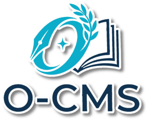

<p align="center">
  
</p>

<h1 align="center">O-CMS</h1>

<p align="center">
  A lightweight, elegant flat-file CMS built with PHP and JSON. No database required.
</p>

<p align="center">
  
  
  
</p>

<p align="center">
  <strong>English</strong> · <a href="README.it.md">Italiano</a>
</p>

---

## Why O-CMS?

Most CMS platforms require MySQL, Composer, and a complex deployment pipeline. O-CMS takes a different approach: **everything is a JSON file**. Upload the folder, run the installer, done. Your entire site fits in a ZIP file and can be migrated by copying a directory.

O-CMS is ideal for personal sites, school projects, documentation portals, small business websites, and anyone who wants a powerful CMS without infrastructure overhead.

---

## Features

### Content Management
- **Pages** — Static pages with WYSIWYG editor, SEO fields, and custom templates
- **Articles** — Full blog system with categories, tags, cover images, excerpts, and comments
- **Lessons** — Educational content type with file attachments (HTML, PDF, video)
- **Quizzes** — Interactive quiz system with multiple question types and result tracking
- **Galleries** — Image gallery management with grid and masonry layouts
- **Forms** — Visual form builder with 10 field types and email notifications
- **Comments** — Threaded comment system with moderation and admin replies

### Administration
- **Dark-themed Admin Panel** — Modern, responsive interface built with vanilla CSS
- **Menu Builder** — Drag-and-drop navigation with unlimited nesting
- **Media Manager** — Upload, browse, and manage files with drag-and-drop
- **Layout Builder** — Visual page builder with 18 module types (text, image, gallery, video, cards, and more)
- **User Roles** — 5-tier hierarchy: Super Admin, Admin, Editor, Publisher, Registered
- **Analytics** — Built-in anonymous visitor tracking with daily charts
- **Backup & Restore** — Full backup system with one-click migration

### Developer Features
- **Theme Engine** — Pluggable themes with guided wizard and ZIP install/export
- **Extension System** — Full plugin architecture with hooks, lifecycle events, and admin menus
- **REST API** — JSON endpoints for articles, pages, categories, menus, settings, and more
- **Search Engine** — Full-text search with fuzzy matching, relevance scoring, and autocomplete
- **AI Integration** — Multi-provider content generation (Anthropic, OpenAI, Groq, Mistral, Google)
- **SEO Tools** — Per-page meta tags, automatic sitemap, robots.txt, code injection

---

## Language

The admin panel interface is currently in **Italian**. The installation wizard and code comments are in English. Full internationalization (i18n) support is planned for a future release.

---

## Requirements

| Requirement | Details |
|---|---|
| PHP | 8.0 or higher |
| Web Server | Apache with `mod_rewrite`, or Nginx |
| Extensions (required) | `json`, `mbstring`, `session`, `fileinfo` |
| Extensions (optional) | `zip` (backups), `gd` (image resize), `curl` (AI, APIs), `intl` (i18n) |
| Disk Space | ~5 MB for the CMS + your content |
| Database | **None** |

---

## Quick Start

### 1. Download

```bash
git clone https://github.com/b84an/o-cms.git
```

Or download the [latest release](https://github.com/b84an/o-cms/releases) as a ZIP.

### 2. Upload

Copy the `o-cms/` folder to your web server's document root (or a subdirectory).

### 3. Install

Open your browser and visit:

```
https://yourdomain.com/install.php
```

The installation wizard will guide you through 6 steps:

1. **Requirements** — Verifies PHP version, extensions, and permissions
2. **Site Configuration** — Name, URL, language, timezone
3. **Admin Account** — Create your first administrator
4. **Email** — SMTP or PHP mail() setup (optional, can be configured later)
5. **Privacy** — Transparent disclosure about the installation notification
6. **Summary** — Review and confirm

### 4. Delete install.php

After installation, remove `install.php` from your server for security.

### 5. Start Creating

Visit `/admin/` to access the admin panel and start building your site.

---

## Directory Structure

```
o-cms/
├── index.php          # Frontend entry point
├── .htaccess          # URL rewriting
├── core/              # CMS engine (10 PHP files)
├── admin/             # Admin panel
├── themes/            # Installed themes
│   └── flavor/        # Default theme
├── extensions/        # Plugins
├── data/              # JSON data (auto-created by installer)
└── uploads/           # User files
```

See [ARCHITECTURE.md](ARCHITECTURE.md) for full details on the data model, request flow, extension system, and API.

---

## Configuration

All settings are stored in `data/config.json` and can be edited through the admin panel under **Settings**:

- Site name, description, and URL
- Theme selection
- Language and timezone
- SMTP email configuration
- SEO settings (robots.txt, code injection)
- AI provider configuration
- Maintenance mode

---

## Themes

O-CMS ships with the **Flavor** theme — a clean, responsive design with dark/light mode support.

### Creating a Theme

Use the built-in **Theme Wizard** in the admin panel, or create one manually:

```
themes/my-theme/
├── theme.json         # Name, author, colors, font
├── assets/
│   ├── css/style.css
│   └── js/app.js
├── partials/
│   ├── header.php
│   └── footer.php
└── templates/
    ├── home.php
    ├── page.php
    ├── article.php
    ├── blog.php
    ├── search.php
    └── 404.php
```

Themes use CSS variables for colors and can be customized through `theme.json`.

---

## Extensions

Extensions add functionality through a hook-based architecture.

### Creating an Extension

Use the **Extension Wizard** in the admin panel to scaffold a new extension, or create one manually:

```
extensions/my-extension/
├── extension.json     # Manifest
├── boot.php           # Runs on every request (when enabled)
├── install.php        # Runs once on installation
└── uninstall.php      # Cleanup on removal
```

Extensions can register routes, hook into events, and add admin menu items. See [ARCHITECTURE.md](ARCHITECTURE.md) for the full extension API.

---

## What's new in 2.0

- **New look**: a shared "lake at night" design system for admin and site (blue glassmorphism, animated aurora, automatic light/dark theme, self-hosted fonts). The default theme `flavor` was rewritten from scratch and now covers every content type: blog, lessons, quizzes, galleries, sign-in sheets (FoglioFirme), search, maintenance page.
- **Admin**: collapsible sidebar groups, command palette (Ctrl/Cmd+K), toast notifications, local draft autosave in the editors, "scheduled" badge for future posts, line-by-line revision diff.
- **Security**: many fixes (SMTP header injection in the contact form, upload of executable files, role escalation, empty-CSRF-token bypass, sanitizer bypasses, quiz answers exposed to the browser, brute force on login and quiz codes). See [CHANGELOG.md](CHANGELOG.md).
- **Reliability**: every JSON write is atomic and locked; no more lost sign-ins, form submissions or statistics under concurrent access; renaming a slug keeps views and revisions.
- **Updater**: verifies the SHA-256 checksum of the release package, keeps your custom `.htaccess` rules, removes obsolete core files.

## Upgrading from 1.x

1. **Back up** the whole site folder (at least `data/`, `.htaccess` and any theme you changed).
2. Download `o-cms-2.0.0.zip` from the [Releases](../../releases) page.
3. Upload and overwrite `core/`, `admin/`, `assets/`, `themes/flavor/` and `index.php`. Do **not** touch `data/` and `uploads/`: the data format is unchanged, no migration is needed.
4. Replace `.htaccess` with the new one. If you had your own rules (301 redirects, etc.), put them between the lines `# === PERSONALIZZAZIONI DEL SITO ===` and `# === FINE PERSONALIZZAZIONI ===`: future automatic updates keep that block.
5. If `install.php` is still on the server, delete it.
6. Log in to the admin and open **Settings**: check the admin email (the contact form now writes to it), choose the `flavor` theme if you want the new look, save. Saving also regenerates `sitemap.xml` and `robots.txt`.
7. From 2.0 on, **Updates** in the admin can install new releases by itself.

---

## REST API

O-CMS includes a JSON REST API for reading and writing content programmatically.

```bash
# List articles
curl -H "Authorization: Bearer YOUR_TOKEN" https://yourdomain.com/api/articles
# (also available as /admin/api/...)

# Create an article
curl -X POST https://yourdomain.com/api/articles \
  -H "Authorization: Bearer YOUR_TOKEN" \
  -H "Content-Type: application/json" \
  -d '{"title": "Hello World", "slug": "hello-world", "content": "<p>...</p>", "status": "published"}'
```

API tokens are managed in the admin panel under **API**.

---

## Security

- Passwords hashed with bcrypt (`password_hash`)
- CSRF protection on all forms
- Input sanitization with `htmlspecialchars`
- `data/` directory protected by `.htaccess`
- Session ID regeneration after login
- Rate limiting per session and per IP on login, registration, comments, contact form and quiz codes
- Math captcha on public forms
- Uploads: extension must match the real content; scripts are never executable inside `uploads/`
- Atomic, locked JSON writes
- PHP errors hidden in production (create an empty `data/.debug` file to show them)

---

## Installation Notification

O-CMS sends a **one-time anonymous ping** when a new instance is installed. This helps the maintainer track adoption and prioritize development. The notification fires once on the first admin panel access and is not repeated.

**What is sent:** domain name, PHP version, O-CMS version.
**What is NOT sent:** personal data, IP addresses, usage data, cookies.

This feature cannot be disabled. It is a lightweight, privacy-respectful condition of using O-CMS. The installer clearly discloses it before installation.

---

## Contributing

Contributions are welcome! Feel free to:

1. Fork the repository
2. Create a feature branch (`git checkout -b feature/my-feature`)
3. Commit your changes
4. Push to the branch (`git push origin feature/my-feature`)
5. Open a Pull Request

Please ensure your code follows the existing style and includes appropriate comments.

---

## License

MIT License. See [LICENSE](LICENSE) for details.

---

## Author

Created by [Ivan Bertotto](https://ivanbertotto.it) — a computer science teacher who built this CMS to prove that not everything needs a database.
